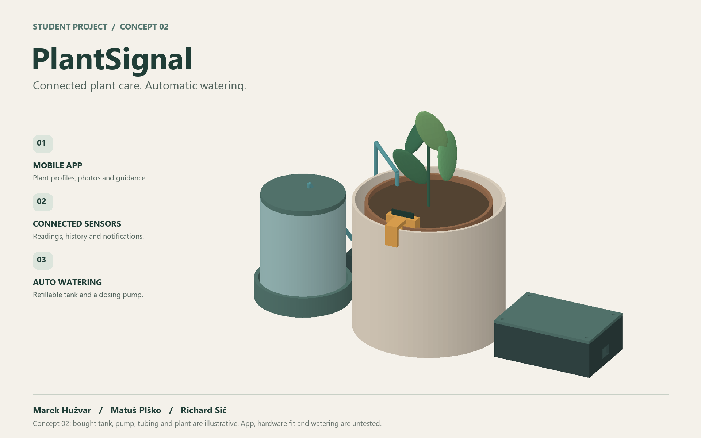

---
# 🧩 Versioning – systém dopĺňa automaticky
fm_version: "1.0.1"

# Dátum buildu – generuje skript
fm_build: "2026-10-19T12:19:50.971435+00:00"

# Poznámka k verzii – voliteľné
fm_version_comment: ""

# 🆔 IDENTITY --------------------------------------------------------

# ID generuje CLI / skript
id: "PRJ-TBD-PlantSignal"

# Unikátne UUID – generuje skript
guid: "5c369feb-8976-4cbb-9257-3d2ee6206adb"

# 🧭 CONTEXT ---------------------------------------------------------

# DAO / doména (knife, sdlc, q12, 7ds...) dopĺňa skript
dao: "sthdf"

# Názov zápisu – dopĺňa používateľ
title: "PlantSignal — STHDF project dashboard"

# Krátky popis – dopĺňa používateľ (voliteľné)
description: "PlantSignal concept 02: mobile plant care, connected sensors and automatic watering; not implemented."

# 👥 AUTHORSHIP ------------------------------------------------------

# Hlavný autor – z globálneho configu
author: "Marek Hužvar; Matuš Plško; Richard Sič"

# Zoznam autorov – generuje skript
authors:
  - "Marek Hužvar"
  - "Matuš Plško"
  - "Richard Sič"

# 🗂 CLASSIFICATION ---------------------------------------------------

# Nadradená kategória – môže doplniť používateľ
category: ""

# Typ dokumentu (guide, case, tutorial...) – používateľ (voliteľné)
type: ""

# Priorita (low/medium/high) – voliteľné
priority: ""

# Tagy – odporúča sa 2–6 tagov.
# Typy tagov:
#   - rámce: knife, 7ds, sdlc, q12
#   - účel: tutorial, guide, pattern, case-study
#   - téma: git, backup, ai, communication
#   - úroveň: beginner, intermediate, advanced
tags: []

# 🌍 LOCALIZATION -----------------------------------------------------

# Jazyk dokumentu – doplní skript podľa štruktúry
locale: "en"

# 🕒 LIFECYCLE --------------------------------------------------------

# Dátum vytvorenia – generuje skript
created: "2026-10-19 14:19"

# Dátum poslednej úpravy – dopĺňa človek
modified: "2026-10-26"

# Stav dokumentu – default "backlog"
status: "inprogress"

# Viditeľnosť – default "public"
privacy: "public"

# ⚖ INTELLECTUAL PROPERTY -------------------------------------------

# Držiteľ práv k obsahu – dopĺňa skript
rights_holder_content: "Marek Hužvar; Matuš Plško; Richard Sič"

# Systémový vlastník práv
rights_holder_system: "CAA / KNIFE / LetItGrow"

# Licencia
license: "CC-BY-4.0"

# Disclaimer
disclaimer: "Use at your own risk. Methods provided as-is; participation is voluntary and context-aware."

# Copyright
copyright: "© 2026 Marek Hužvar; Matuš Plško; Richard Sič"

# 🔗 ORIGIN / PROVENANCE ---------------------------------------------

# Repozitár pôvodu
origin_repo: "06-STH-Projects/2026_sthdf_class_template"

# URL pôvodného repozitára
origin_repo_url: "https://github.com/06-STH-Projects/2026_sthdf_class_template"

# Commit pôvodu
origin_commit: "d30dd1dfe166e97d95ad7ffca26d84ca73fa2b64"

# Branch pôvodu
origin_branch: ""

# Systém pôvodu (CAA/KNIFE/STHDF…)
origin_system: "STHDF"

# Pôvodný autor
origin_author: "Roman Kazička / STHDF template contributors"

# Importovaný zdroj
origin_imported_from: ""

# Dátum importu
origin_import_date: "2026-10-19"

# 🧱 RESERVED ---------------------------------------------------------

fm_reserved1: ""
fm_reserved2: ""
---

# PlantSignal — STHDF project dashboard

**Concept 02, updated 26 October 2026.** Project number and ST roster IDs remain unassigned; `PRJ-TBD-PlantSignal` is temporary. Team: Marek Hužvar · Matuš Plško · Richard Sič.

The active direction is a mobile app linked to sensors and automatic watering from a refillable reservoir. The app holds a plant species/type profile, readings/history, notifications and photo-based care questions through an external API. Product status LEDs have been removed.

## Seven required deliverables

1. [About Me](students/about-me/index.md) — team identified; personal profiles pending.
2. [Knowledge Contribution](students/knowledge-contribution/index.md) — two local KNIFE drafts.
3. [Project Summary](students/project-summary/index.md) — revised scope and proposed milestones.
4. [Project Outcomes](students/project-outcomes/index.md) — digital concept evidence only.
5. [Pitch Presentation](students/pitch-presentation/index.md) — revised outline.
6. [Final Presentation](students/final-presentation/index.md) — not started.
7. [Reflexia](students/reflexia/index.md) — to be completed by the actual members.

## Design and work

- [7Ds / SDLC / Q12](projects/index.md)
- [Current concept](../../../../../docs/CONCEPT.en.md)
- [Proposed architecture](../../../../../docs/ARCHITECTURE.en.md)
- [App scope](../../../../../docs/APP_FEATURES.en.md)
- [Local watering policy and planned tests](../../../../../docs/WATERING_CONTROL.en.md)
- [CAD and print assumptions](../../../../../models/README.md)
- [Slovak summary](../../../../../docs/PROJECT_BRIEF.sk.md)

**Not implemented:** mobile app, firmware, backend, sensor/pump integration, notifications, photo API, physical printing and watering tests. Controller, framework and providers are proposals/open decisions. Class-dashboard integration remains the teacher's process.
