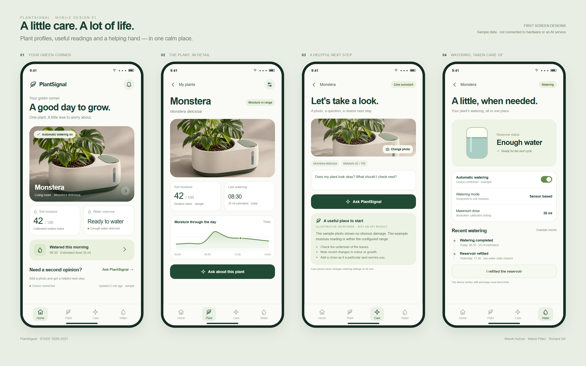

# PlantSignal — industrial design 03 and app design 01

**26 October 2026.** The earlier separated bottle/box visual is replaced by a compact integrated planter: matte ivory shell, recessed forest-green base, sage refill lid and passive water-level window. Product status LEDs remain excluded.


The studio visual was generated with the built-in imagegen tool. [Prompt and provenance](../assets/product/generation-notes.md). The [actual CAD files](../models/v3/README.md) describe editable geometry with a close design direction; the studio visual is not a literal render of those meshes or evidence of a built device.

## First app screens



| Screen | Preview | Intended action |
|---|---|---|
| My plants | [01-home.png](../assets/app/01-home.png) | See the plant, moisture index, reservoir state and recent watering |
| Plant detail | [02-plant.png](../assets/app/02-plant.png) | Review species, measurements and example trend |
| Care assistant | [03-care.png](../assets/app/03-care.png) | Select a photo, ask a question and review an illustrative response |
| Watering | [04-watering.png](../assets/app/04-watering.png) | Inspect local-policy status, toggle the design state and acknowledge refill |
| Plant profile | [05-add.png](../assets/app/05-add.png) | Enter the name, species/type and location |

The [clickable app prototype](../prototypes/app/index.html) is authored HTML/CSS/JavaScript, not a compiled mobile app. Navigation, profile editing, a local photo preview, example advice, a watering switch and refill feedback can be clicked. All readings, timing, dose values, trend points and answers are **sample data**. There are no API calls, device commands, notification delivery, accounts or persistent server storage.

The moisture number is a relative index, not a measured volumetric water percentage. Reservoir status is a low-water/ready state, not a measured exact remaining volume. Example advice never changes watering settings. A selected photo stays in the browser preview.

## Interactive 3D model

Open the [model viewer](../prototypes/model/index.html) to rotate the actual GLB, zoom, show/hide the optional plant reference and inspect an exploded view. The default view shows the physical enclosure rather than decorative plant geometry.


## Run locally

From the repository root:

```sh
python -m http.server 8765 --bind 127.0.0.1
```

Then open `http://127.0.0.1:8765/prototypes/app/index.html` or `http://127.0.0.1:8765/prototypes/model/index.html`. The app also opens directly as a local file. The 3D viewer needs a local HTTP server and WebGL. Three.js preview dependencies are included under `prototypes/vendor/` with their MIT license; no CDN connection is required to run the viewer.

## Verification performed

- Five 390 × 844 screen designs rendered without content clipping in the initial state.
- App navigation, profile edits and species selection updated the visible design.
- Watering toggle and refill/advice controls showed explicit simulation feedback.
- The narrow 320 px presentation did not overflow horizontally.
- No browser page exceptions were reported in those checks.
- The actual GLB loaded and rendered, and the exploded-view toggle changed the scene.
- Exported CAD STLs reloaded with positive volume, closed surfaces and one connected solid per component.

These checks cover design assets and the local prototype. Physical fit, printing/support strategy, water containment, sensors, pump control and mobile/backend integration remain untested.
