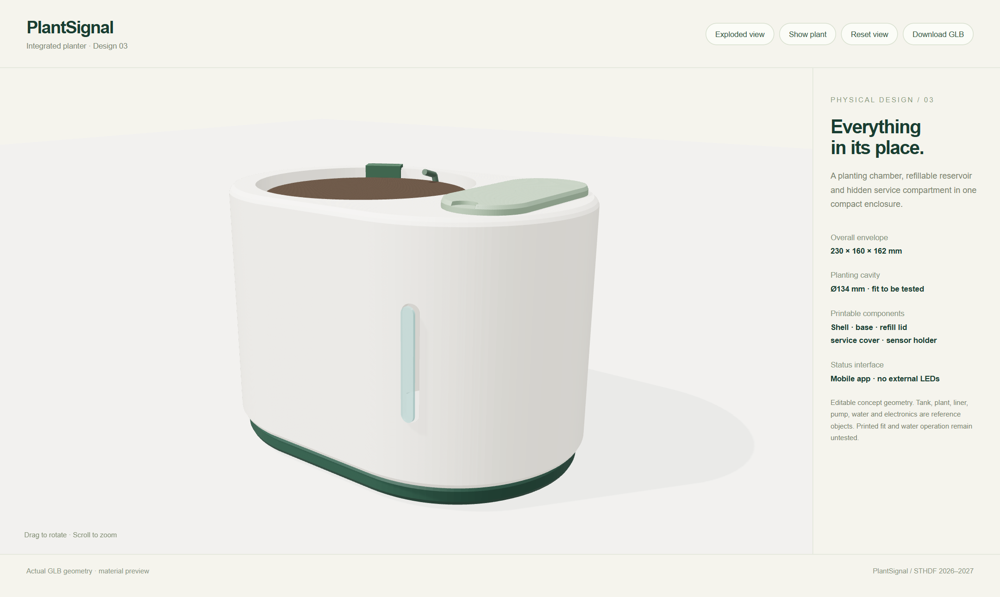

# PlantSignal — current mechanical design

The active model is **integrated design 03**, replacing the separated planter, reservoir bottle and external controller box.

- [Full model guide and five STL parts](v3/README.md)
- [GLB assembly](v3/assembly.glb) · [Product-only GLB](v3/product.glb)
- [Exact Python CAD source](v3/build_model.py) · [OpenSCAD counterpart](v3/product.scad)
- [Interactive model viewer](../prototypes/model/index.html)
- [Geometry validation](v3/mesh-validation.json)

The rounded outer body combines the planting chamber, reservoir bay and service compartment. Product status LEDs remain removed. The narrow front opening is a passive water-level-window concept. The body footprint is 230 × 160 mm; the refill lid reaches 162 mm high and the rear panel adds about 2 mm depth.

All exported components are closed, positive-volume single solids. Dimensions, fasteners, tank/liner selection, print support/orientation, seals and water operation need real component checks and sample prints. The studio image is an AI-generated design visualization, not a literal CAD render or a built-product photo.

Earlier files in `models/stl/` and Git history are legacy concept parts. Use `models/v3/` for current work. The top-level GLB, OpenSCAD and mesh-report paths point to the current design for existing documentation links.

[Product and app preview guide](../docs/DESIGN_PREVIEW.en.md) · [Functional scope](../docs/CONCEPT.en.md)
