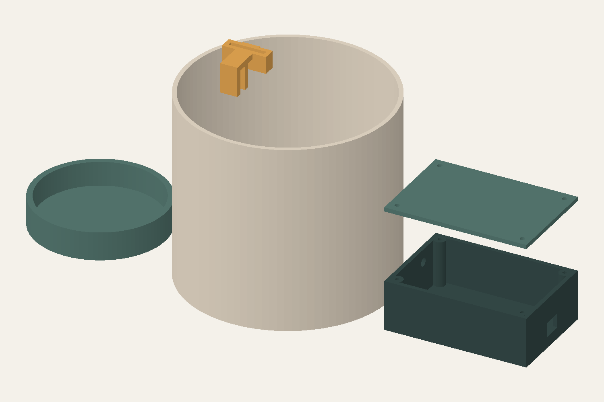

# Mechanical concept 02 — connected automatic watering

**Revised 26 October 2026.** Units: **millimetres** for STL and OpenSCAD. No physical print, electrical fit or hydraulic test has been performed.

The controller lid is solid except for its four fastener holes. The former LED holes and LED objects have been removed. A dry support cradle has been added for a purchased refillable tank. The app is the intended status/notification interface.

## Files and dimensions

| File | Intended purpose | Concept dimensions |
|---|---|---|
| [sleeve.stl](stl/sleeve.stl) | Decorative outer cover for bought pot and saucer | Ø144 × 130 mm; Ø138 cavity, 3 mm wall/floor, four drain holes |
| [electronics-base.stl](stl/electronics-base.stl) | Dry controller/driver enclosure | 100 × 68 × 35 mm, approximate connector openings |
| [electronics-lid.stl](stl/electronics-lid.stl) | Solid lid with four screw holes | 100 × 68 × 3 mm; four Ø3.4 mm holes, no indicator openings |
| [sensor-clip.stl](stl/sensor-clip.stl) | Repeatable removable probe support | 31 × 30 × 21 mm; 6 mm rim gap, 25 × 3.2 mm probe slot |
| [reservoir-cradle.stl](stl/reservoir-cradle.stl) | Dry support for a bought tank | Ø92 × 20 mm; Ø84 cavity, 3 mm floor |
| [plant-signal.scad](plant-signal.scad) | Editable source of the five printed parts | Select a part or the assembly |
| [assembly-concept.glb](assembly-concept.glb) | Coloured assembly with context objects | Geometry converted from mm to metres for GLB |
| [mesh-validation.json](mesh-validation.json) | Exported-mesh checks | Closed surface, one solid, bounds and volume |

STL does not encode units: choose mm in the slicer. The bought liner is an assumed Ø120 × 110 mm envelope and saucer Ø128 × 15 mm. The rendered tank is an assumed Ø80 × 100 mm envelope; it is not a selected product and its capacity is unknown. The current case footprint is retained as a starting point, not confirmed to fit the new controller/driver or power arrangement.

## Printed versus illustrative objects

Only the five STL components are printable designs. The plant, liner, soil, probe, reservoir, cap, water, pump and tubing in the GLB/render are illustrations. The water route, pump placement, tube sizes, connectors and mounting must be redesigned around actual selected hardware. No app screens, wiring or working controller are represented.

The reservoir cradle is not a watertight reservoir. Use a bought tank initially. The sleeve drains through its floor and needs a separate bought watertight saucer. The controller enclosure is not waterproof.

## Editing and fit work

Open `plant-signal.scad` and set `part` to `sleeve`, `electronics-base`, `electronics-lid`, `sensor-clip`, `reservoir-cradle` or `assembly`. Render before exporting the chosen component. Sleeve/enclosure dimensions have named parameters; screw posts, ports and clip geometry also need explicit adjustment when dimensions change.

Before a printing release:

1. Measure the actual pot, saucer, refillable tank, pump, board, driver, connectors and tubing.
2. Add proper board/pump mounting, cable retention and a removable tube support; verify refill and service access.
3. Keep sensor components and electronics outside soil/water exposure. Validate the water path, passive flow/siphoning, leaks and low-water stop on real hardware.
4. Trial-print clip/fastener samples and inspect orientation/supports in the slicer before full printing. A 0.2 mm layer profile is a starting point, not a verified setting.
5. Test screw selection against the Ø2.6 mm pilot holes. Reposition ports for the chosen new hardware; old positions are placeholders.

## Verification and limits

Each exported STL was reloaded and checked for a watertight surface, positive volume and one connected solid. The lid's topology was checked for exactly four through-holes corresponding to fasteners. OpenSCAD command-line compilation was not performed; exports were made from equivalent Boolean geometry. These checks do not prove printability, strength, electrical fit, dose accuracy, leak resistance or reliable watering.

The original concept remains available in Git history. Current files intentionally supersede the indicator-based concept; the migration's old-byte preservation check is a historical audit, not the acceptance test for this revision.

[Current product scope](../docs/CONCEPT.en.md) · [Watering policy](../docs/WATERING_CONTROL.en.md)
