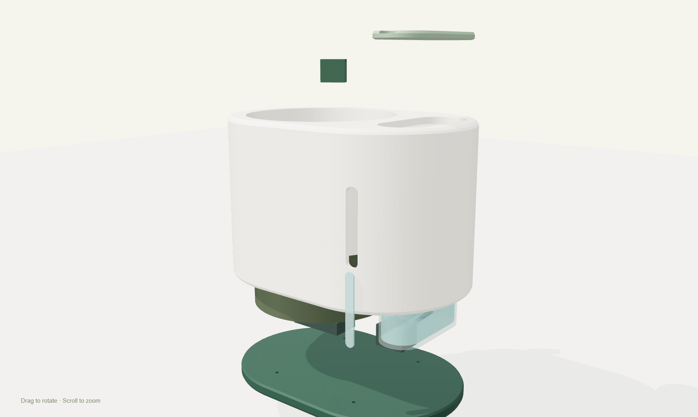

# PlantSignal — integrated mechanical design 03

**26 October 2026.** An actual editable geometric concept with five separately exported components, a materialized GLB assembly and an interactive viewer. Physical fit, print/support strategy, electrical compatibility and hydraulic behavior remain untested.


## Form and boundaries

The product uses one capsule-shaped 230 × 160 mm outer body with softened edge profiles. The refill lid reaches 162 mm above the base. The rear service cover adds about 2 mm to the main body's depth. A Ø134 mm planting cavity occupies the left section; a 42 × 96 mm refill opening and separate reservoir envelope occupy the right section. The bottom/rear area represents a serviceable dry controller/pump compartment.

The narrow front feature is a **passive level-window concept**, not an LED or electronic display. A transparent insert and a visible compatible reservoir would need to be selected and sealed/retained appropriately. The rendered reservoir is only a 38 × 90 × 100 mm envelope, not a confirmed off-the-shelf tank, capacity claim or watertight manufactured part.

## Files

| File | Purpose |
|---|---|
| [assembly.glb](assembly.glb) | Materialized assembly, including reference plant and hardware objects; units are metres |
| [product.glb](product.glb) | Product and hardware reference geometry without the decorative plant |
| [main-shell.stl](stl/main-shell.stl) | Capsule enclosure, planting well, refill opening, passive window and service access |
| [base-plinth.stl](stl/base-plinth.stl) | Recessed base with four fastener clearances |
| [refill-lid.stl](stl/refill-lid.stl) | Rounded removable fill lid with finger recess |
| [rear-service-cover.stl](stl/rear-service-cover.stl) | Small rounded rear access panel |
| [sensor-holder.stl](stl/sensor-holder.stl) | Removable rim/probe support concept |
| [build_model.py](build_model.py) | Exact Boolean/loft source used to export the supplied geometry |
| [product.scad](product.scad) | Parametric OpenSCAD counterpart for editing/inspection |
| [mesh-validation.json](mesh-validation.json) | Exported mesh bounds, volumes, triangle counts and validity checks |

STL dimensions are **millimetres**. GLB positions are converted to **metres**. Exported STLs have their lowest Z moved to zero, but still require appropriate orientation, placement and supports in the slicer. The rear panel should be placed flat before printing. OpenSCAD compilation was not performed; the supplied exports were generated by the Python source.

## Inspect and rebuild

The [viewer](../../prototypes/model/index.html) supports rotation, zoom and exploded assembly inspection. Run a local HTTP server as described in the [design preview guide](../../docs/DESIGN_PREVIEW.en.md).

To rebuild the exact exports in a suitable Python environment:

```sh
python -m pip install -r models/v3/requirements.txt
python models/v3/build_model.py
```

The source contains the dimensions and component construction; edit them after measuring the real pot, liner/saucer, controller, driver, pump, tank and tube fittings. The current internal arrangement is a packaging concept, not a finalized seal/connector/mount design or a print release.



## Validation and physical work remaining

Each STL was reloaded and checked for positive volume, a watertight mesh surface and exactly one connected solid. “Watertight” here means a closed digital mesh; it does not mean a printed part retains water. Tank, water, transparent window, pump, tube, controller, soil, liner and plant in the GLB are reference objects rather than additional verified printable components.

Next work includes actual tank/liner selection, dry/wet separation, fastener fit, tube retention, flow/siphon/leak checks, support/splitting strategy and sample prints. The earlier separated-component concept remains in Git history and legacy files; this directory is the active mechanical design.

## Studio visualization

The [photorealistic product image](../../assets/product/plantsignal-studio-v3.png) was generated with imagegen as an industrial-design visualization. It is not a literal renderer output of these CAD meshes. The screenshot above shows the actual exported geometry. [Generation prompt](../../assets/product/generation-notes.md).
